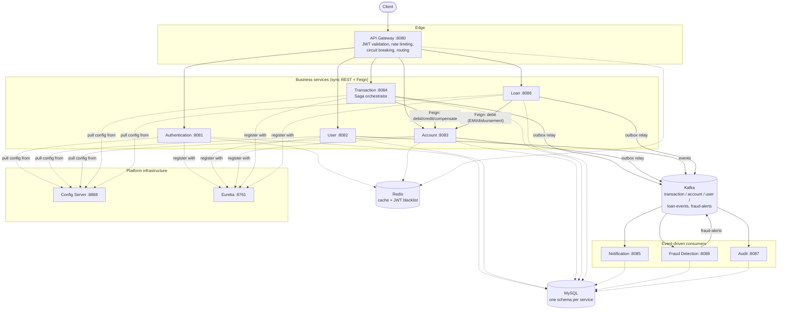

# Enterprise Distributed Banking Transaction Platform

A production-shaped banking backend built as eleven independently deployable Spring Boot microservices: account management, Saga-orchestrated fund transfers, loan origination, rule-based fraud detection, an immutable audit trail, and everything around them — service discovery, centralized config, an API gateway, event-driven messaging, distributed tracing, and metrics.

This isn't a CRUD demo with a database behind it. It's an attempt to build the thing a mid-sized fintech's platform team would actually run: services that fail independently and recover without losing money or data, a message backbone instead of services calling each other in a chain, and infrastructure-as-code for both a laptop and a cluster.

[](https://adoptium.net)
[](https://spring.io/projects/spring-boot)
[](LICENSE)

## Table of contents

- [Architecture at a glance](#architecture-at-a-glance)
- [Service catalog](#service-catalog)
- [What's actually in here](#whats-actually-in-here)
- [Tech stack](#tech-stack)
- [Getting started](#getting-started)
- [Walkthrough: a transfer, end to end](#walkthrough-a-transfer-end-to-end)
- [Running the tests](#running-the-tests)
- [Running on Kubernetes](#running-on-kubernetes)
- [Observability](#observability)
- [CI/CD](#cicd)
- [Project structure](#project-structure)
- [Further reading](#further-reading)
- [What's deliberately out of scope](#whats-deliberately-out-of-scope)
- [Author](#author)

## Architecture at a glance



Every business service owns its own MySQL schema — nothing reaches across into another service's tables. Synchronous calls (Feign, over HTTP) are used only where a request genuinely can't proceed without an immediate answer (Transaction Service needs to know *now* whether a debit succeeded). Everything else — telling Notification Service to send an email, telling Fraud Detection Service a transfer happened, telling Audit Service to record it — happens asynchronously over Kafka, so a slow or momentarily-down consumer never blocks the request that triggered it.

## Service catalog

| Service | Port | Responsibility | Database |
|---|---|---|---|
| Config Server | 8888 | Centralized `application.yml` for every service (Spring Cloud Config, native/classpath backend) | — |
| Eureka (Discovery Server) | 8761 | Service registry — everything else registers here and discovers peers by name | — |
| API Gateway | 8080 | Single public entry point: JWT validation, per-user rate limiting, circuit breaking, routing | — |
| Authentication Service | 8081 | Registration, login, JWT issuance/refresh, logout with token blacklisting | `auth_db` |
| User Service | 8082 | Profiles, KYC status (gates account opening) | `user_db` |
| Account Service | 8083 | Accounts, balances, beneficiaries, fixed deposits, Redis-cached balance reads | `account_db` |
| Transaction Service | 8084 | Fund transfers: Saga orchestration, transactional outbox, idempotency | `transaction_db` |
| Notification Service | 8085 | Consumes every domain event, sends email (MailHog in dev) | `notification_db` |
| Loan Service | 8086 | Loan applications, approval workflow, EMI schedule, disbursement | `loan_db` |
| Audit Service | 8087 | Immutable, tamper-evident log of every domain event across the platform (admin-only) | `audit_db` |
| Fraud Detection Service | 8088 | Rule-based post-transfer risk scoring (large amount, velocity, new beneficiary) | `fraud_db` |

Plus the infrastructure containers: MySQL, Kafka (KRaft mode, no Zookeeper), Redis, Zipkin, Prometheus, Grafana, and MailHog — all wired up in `docker-compose.yml`.

## What's actually in here

**Security** — JWT (HS256) issued by Authentication Service, validated at the gateway *and* independently by every downstream service (defense in depth — a service reachable directly, not just through the gateway, still enforces its own auth). Logout blacklists the access token's JTI in Redis, checked on every gateway request. Service-to-service calls that aren't a passthrough of a user's own request use a static internal API key instead of a forwarded JWT.

**Reliability** — every fund transfer runs as an orchestrated Saga: debit, then credit, and if the credit leg fails after the debit already succeeded, an explicit compensating transaction reverses it. State transitions and the outbound event are written in the same database transaction (the transactional outbox pattern), so "the transfer happened" and "we owe Kafka a message about it" can never disagree. Resilience4j circuit breakers and retries wrap every synchronous inter-service call.

**Event-driven architecture** — Kafka topics per domain (`transaction-events`, `account-events`, `user-events`, `loan-events`, `fraud-alerts`), each with a dead-letter topic. Notification, Fraud Detection, and Audit all consume the same event streams independently — adding a fourth consumer tomorrow needs zero changes to any producer.

**Fraud detection** — a genuinely separate service, not a method call bolted onto the transfer flow: it consumes `transaction-events` asynchronously and evaluates three rules (large amount, transfer velocity, new beneficiary), publishing `fraud-alerts` when something trips. Explicitly a *detective* control (it can only flag a transfer after the fact), not a preventive one — see [`docs/ARCHITECTURE.md`](docs/ARCHITECTURE.md) for why that's a deliberate, honest scope boundary rather than an oversight.

**Auditability** — every domain event, from every service, lands in an append-only audit log with a per-record SHA-256 integrity hash and MySQL triggers that physically block `UPDATE`/`DELETE` on the table. Queryable by an admin with dynamic filters (domain, event type, actor, time range).

**Observability** — structured JSON logs, Micrometer metrics scraped by Prometheus with pre-wired Grafana dashboards, and distributed tracing via Zipkin so a single request's path across five services shows up as one trace.

**Deployability** — a single `docker compose up --build` for local dev, and a parallel set of Kubernetes manifests (namespace, secrets, ConfigMaps, Deployments with readiness/liveness probes, an HPA example) for anything closer to a real cluster.

## Tech stack

- **Language / runtime:** Java 21
- **Framework:** Spring Boot 3.2.5, Spring Cloud 2023.0.1 (Config, Eureka, Gateway, OpenFeign, LoadBalancer)
- **Resilience:** Resilience4j (circuit breaker, retry)
- **Messaging:** Apache Kafka (KRaft mode)
- **Data:** MySQL 8, Flyway migrations, Spring Data JPA/Hibernate, Redis
- **Security:** Spring Security (OAuth2 Resource Server), JWT (`jjwt` / Nimbus JOSE)
- **Observability:** Micrometer, Prometheus, Grafana, Zipkin, Logstash-encoded JSON logging (optional ELK overlay)
- **API docs:** springdoc-openapi (Swagger UI on every business service)
- **Testing:** JUnit 5, Mockito, AssertJ, Testcontainers, WireMock, Awaitility
- **Containers/orchestration:** Docker, Docker Compose, Kubernetes
- **CI/CD:** GitHub Actions (build/test, Docker image build, Kubernetes manifest validation, full-stack smoke test, CodeQL)

## Getting started

### Prerequisites

- Docker Desktop (or Docker Engine + Compose v2) — this is the only hard requirement to run the whole platform
- JDK 21 — only needed if you want to build/run a service outside Docker, or open the project in an IDE
- ~4 GB of free RAM for Docker (18 containers, mostly small, but MySQL/Kafka/Elasticsearch-if-enabled add up)

### Quick start

```bash
git clone <this-repo-url>
cd enterprise-banking-platform
cp .env.example .env        # optional: override JWT secret / passwords for anything beyond local dev
docker compose up --build -d
docker compose ps            # wait for everything to report healthy — first build takes a few minutes
```

Then:

| What | Where |
|---|---|
| API Gateway (the one public entry point) | http://localhost:8080 |
| Eureka — confirm all 9 registered services are up | http://localhost:8761 |
| Swagger UI, per service | `http://localhost:<port>/swagger-ui.html` |
| MailHog — see emails Notification Service sends | http://localhost:8025 |
| Zipkin — distributed traces | http://localhost:9411 |
| Prometheus | http://localhost:9090 |
| Grafana (`admin` / `admin`) | http://localhost:3000 |

(9, not 11, because Config Server and Discovery Server itself don't register as Eureka clients — they're the infrastructure the other 9 register *with*.)

Full IDE setup instructions (for anyone who'd rather click through IntelliJ than read a Dockerfile) are in [`docs/ARCHITECTURE.md`](docs/ARCHITECTURE.md#local-ide-setup).

## Walkthrough: a transfer, end to end

Everything below goes through the gateway at `:8080`. A demo admin is seeded on first boot (`admin` / `Admin@12345`) — see `authentication-service/.../V2__seed_admin.sql`; rotate or delete that row before this ever runs anywhere but a laptop.

```bash
BASE=http://localhost:8080

# 1. Register a customer
curl -s -X POST $BASE/api/v1/auth/register -H 'Content-Type: application/json' -d '{
  "username": "vedanth", "email": "vedanth@example.com",
  "password": "Passw0rd!", "firstName": "Vedanth", "lastName": "R"
}' | tee register.json

# 2. Log in as that customer
TOKEN=$(curl -s -X POST $BASE/api/v1/auth/login -H 'Content-Type: application/json' -d '{
  "username": "vedanth", "password": "Passw0rd!"
}' | python3 -c "import sys,json; print(json.load(sys.stdin)['accessToken'])")
USER_ID=$(python3 -c "import json; print(json.load(open('register.json'))['userId'])")

# 3. Log in as the seeded admin, and verify the new customer's KYC
#    (Account Service refuses to open an account until this is VERIFIED)
ADMIN_TOKEN=$(curl -s -X POST $BASE/api/v1/auth/login -H 'Content-Type: application/json' -d '{
  "username": "admin", "password": "Admin@12345"
}' | python3 -c "import sys,json; print(json.load(sys.stdin)['accessToken'])")

curl -s -X PATCH $BASE/api/v1/users/$USER_ID/kyc-status \
  -H "Authorization: Bearer $ADMIN_TOKEN" -H 'Content-Type: application/json' \
  -d '{"status": "VERIFIED"}'

# 4. Open two accounts for the customer
ACC_FROM=$(curl -s -X POST $BASE/api/v1/accounts -H "Authorization: Bearer $TOKEN" \
  -H 'Content-Type: application/json' -d '{"accountType": "SAVINGS", "currency": "INR"}' \
  | python3 -c "import sys,json; print(json.load(sys.stdin)['id'])")

ACC_TO=$(curl -s -X POST $BASE/api/v1/accounts -H "Authorization: Bearer $TOKEN" \
  -H 'Content-Type: application/json' -d '{"accountType": "SAVINGS", "currency": "INR"}' \
  | python3 -c "import sys,json; print(json.load(sys.stdin)['id'])")

# 5. Transfer between them (idempotencyKey: retry this exact call safely — it
#    will never double-move money)
curl -s -X POST $BASE/api/v1/transactions/transfer -H "Authorization: Bearer $TOKEN" \
  -H 'Content-Type: application/json' -d "{
    \"fromAccountId\": \"$ACC_FROM\", \"toAccountId\": \"$ACC_TO\",
    \"amount\": 500.00, \"currency\": \"INR\",
    \"idempotencyKey\": \"$(python3 -c 'import uuid; print(uuid.uuid4())')\"
  }"

# 6. Check MailHog (localhost:8025) for the transfer notification, Zipkin
#    (localhost:9411) for the trace across Gateway -> Transaction -> Account,
#    and the admin-only audit trail for the same event:
curl -s "$BASE/api/v1/audit/events?domain=TRANSACTION" -H "Authorization: Bearer $ADMIN_TOKEN"
```

A transfer over ₹200,000, to a beneficiary the sender has never paid before, or the sixth transfer from one account inside ten minutes will each independently trip a Fraud Detection rule — check `GET /api/v1/fraud/rules/config` (admin) for the exact thresholds, or the audit log for the resulting `FRAUD` domain events.

## Running the tests

```bash
mvn -B clean test          # fast: unit tests only (every module)
mvn -B clean verify        # unit tests + Testcontainers-backed integration tests (needs Docker)
```

`transaction-service` has the flagship integration test — `TransferSagaIT` spins up real MySQL and Kafka containers via Testcontainers, stubs Account Service's HTTP contract with WireMock, and proves the happy-path transfer, the compensation path, and idempotent replay all work against real infrastructure, not mocks. It's named `*IT` (not `*Test`) specifically so it's excluded from the fast `mvn test` loop and only runs under Failsafe (`mvn verify`) — see the class Javadoc for the reasoning.

For API-level testing there's also a Postman collection in `postman/` — 36 requests across 9 folders that run end to end as one scenario (register → approve KYC → open accounts → transfer → audit and fraud checks). Tokens and IDs are captured automatically between requests, every response is asserted on, a dedicated folder of negative tests covers missing and malformed tokens, internal endpoints blocked at the gateway, over-limit transfers and privilege escalation, and an idempotency test replays the same transfer and verifies the balance moved only once. Import both JSON files into Postman, pick the *Banking Platform - Local Docker* environment, and run the collection against the Docker Compose stack.

## Running on Kubernetes

```bash
kubectl apply -f k8s/
kubectl -n banking-platform get pods -w      # wait for everything to go Running
kubectl -n banking-platform port-forward svc/api-gateway 8080:8080
```

Manifests are numbered to apply in dependency order (`00-namespace`, `01-secrets`, infra, then each service). See [`docs/ARCHITECTURE.md`](docs/ARCHITECTURE.md#kubernetes-notes) for what's deliberately simplified here versus a real production cluster (secrets management, Kafka's single broker, MySQL as an in-cluster pod instead of a managed service).

## Observability

| Tool | URL | What it's for |
|---|---|---|
| Grafana | http://localhost:3000 | Dashboards over Prometheus metrics (JVM, HTTP, circuit breaker state) |
| Prometheus | http://localhost:9090 | Raw metrics + scrape target health |
| Zipkin | http://localhost:9411 | Distributed traces — search by service or trace ID |
| Actuator, per service | `http://localhost:<port>/actuator/health` | Liveness/readiness, also what Docker/K8s probes hit |

An optional ELK overlay (`docker-compose.elk.yml`) adds centralized log aggregation — not part of the default stack, since Elasticsearch's memory footprint makes it a poor default for a laptop.

## CI/CD

Two GitHub Actions workflows, in `.github/workflows/`:

- **`ci.yml`** — Maven build + unit/integration tests on every push and PR; on pushes to `main`, additionally builds every service's real Docker image, spins up a disposable `kind` cluster to server-side-dry-run every Kubernetes manifest, and brings the entire `docker-compose.yml` stack up to confirm every service actually registers with Eureka and serves valid OpenAPI docs.
- **`codeql.yml`** — static security analysis on every push/PR plus a weekly scheduled sweep.

`.github/dependabot.yml` keeps Maven dependencies, GitHub Actions, and the Docker base/infra images from going stale silently.

## Project structure

```
enterprise-banking-platform/
├── common/                    # Shared DTOs, events, security helpers — no business logic
├── config-server/             # Spring Cloud Config Server (native/classpath backend)
├── discovery-server/          # Eureka
├── api-gateway/               # Routing, JWT validation, rate limiting
├── authentication-service/
├── user-service/
├── account-service/
├── transaction-service/       # Saga orchestration + outbox
├── notification-service/
├── loan-service/
├── audit-service/
├── fraud-detection-service/
├── docker/                    # Shared Dockerfile template, Prometheus/Grafana/Logstash config
├── k8s/                       # Kubernetes manifests, numbered in apply order
├── docs/
│   └── ARCHITECTURE.md        # Deep dive: patterns, trade-offs, scope boundaries
├── postman/                   # API test collection (36 requests) + local environment
├── docker-compose.yml
├── docker-compose.elk.yml     # Optional log-aggregation overlay
├── validate.py                # Structural well-formedness check (pom.xml / yml / yaml)
└── pom.xml                    # Parent reactor POM
```

## Further reading

- [`docs/ARCHITECTURE.md`](docs/ARCHITECTURE.md) — system diagrams, pattern-by-pattern deep dives (Saga, outbox, circuit breaking, idempotency, audit integrity, fraud detection design), the full data model, and every deliberate scope boundary explained.

## What's deliberately out of scope

This project draws an honest line between "demonstrates the pattern correctly" and "is actually production-ready," and says so explicitly rather than pretending otherwise. A few headline examples (full list in `docs/ARCHITECTURE.md`):

- One shared MySQL container with eight schemas, not eight physically separate databases — a local-dev simplification; the application layer already respects service boundaries as if they were separate.
- Kafka runs as a single KRaft broker — enough to prove the event-driven architecture works, not a highly-available cluster.
- The audit log uses a per-record SHA-256 hash plus DB-level append-only triggers, not a hash chain — a deliberate choice given horizontal scaling and multi-partition Kafka consumption, explained in `docs/ARCHITECTURE.md`.
- Kubernetes secrets are plain `stringData` for zero-setup `kubectl apply`, not pulled from a real secrets manager.
- Fraud Detection is a *detective* control by design (flags after the fact) — it cannot block a transfer in-flight, because it only ever sees transfers asynchronously, after the fact, via Kafka.

## Author

**Vedanth R** — B.E. Artificial Intelligence & Machine Learning, Malnad College of Engineering
[vedanthr04@gmail.com](mailto:vedanthr04@gmail.com)

## License

MIT — see [`LICENSE`](LICENSE).
