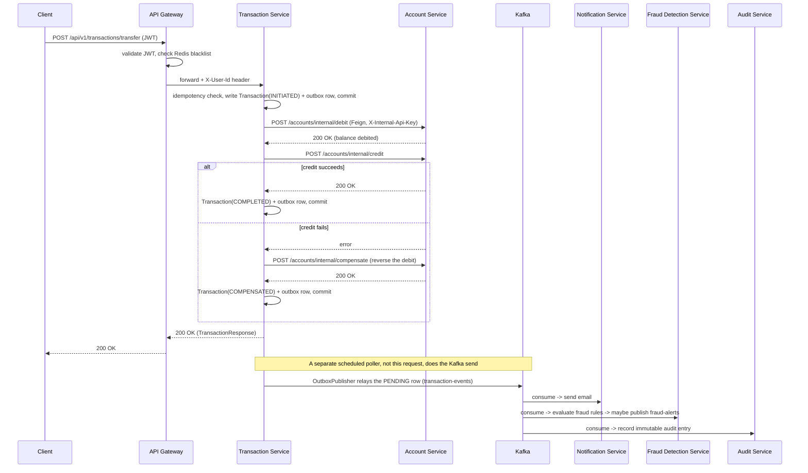

# Architecture

This document goes deeper than the README: the full request-flow walkthroughs, why each major pattern was chosen (and what it costs), the data model, and every place this project draws an explicit line between "demonstrates the pattern correctly" and "is production-ready as written."

## Contents

- [System diagram](#system-diagram)
- [Request flow: a transfer, end to end](#request-flow-a-transfer-end-to-end)
- [Pattern deep dives](#pattern-deep-dives)
  - [Saga orchestration + compensating transactions](#saga-orchestration--compensating-transactions)
  - [Transactional outbox](#transactional-outbox)
  - [Circuit breaking and retry](#circuit-breaking-and-retry)
  - [Event-driven architecture (Kafka)](#event-driven-architecture-kafka)
  - [Idempotency](#idempotency)
  - [Two service-to-service auth patterns](#two-service-to-service-auth-patterns)
  - [Audit log integrity](#audit-log-integrity)
  - [Fraud detection design](#fraud-detection-design)
  - [Caching strategy](#caching-strategy)
- [Data model](#data-model)
- [Local IDE setup](#local-ide-setup)
- [Kubernetes notes](#kubernetes-notes)
- [Scope boundaries](#scope-boundaries)
- [Failure modes considered](#failure-modes-considered)

## System diagram

The request the client is waiting on never touches Kafka directly. It returns as soon as the Saga's two (or three, on the compensation path) synchronous calls resolve. Everything event-driven happens after that response has already gone back to the client, on Transaction Service's own schedule (a 1-second poll by default).

## Request flow: a transfer, end to end

1. **Gateway.** `JwtAuthenticationFilter` (a `GlobalFilter`, order `-1`, so it runs before routing) rejects anything without a valid, non-blacklisted bearer token before it reaches a backend service at all. On success, it strips any caller-supplied `X-User-Id`/`X-User-Roles`/`X-Username` headers and replaces them with values derived from the verified JWT — a client can't forge its own identity by just setting a header.
2. **Transaction Service receives the request**, already carrying a validated identity. `TransferServiceImpl.transfer()` first checks `idempotencyKey` against what's already in the database — a retried request (network blip, double-click) returns the original result instead of moving money twice.
3. A `Transaction` row is written with status `INITIATED`, and an outbox row describing a `TRANSFER_INITIATED` event is written **in the same transaction**. Both commit together or neither does.
4. **Saga step 1: debit.** `AccountServiceGateway.debit(...)` (wrapped in `@Retry` + `@CircuitBreaker`) calls Account Service's internal endpoint. If this fails, the transaction is marked `FAILED` and the saga stops here — nothing to compensate, since nothing moved yet.
5. **Saga step 2: credit.** If this fails *after* the debit already succeeded, Transaction Service issues an explicit **compensating transaction** — a call to Account Service's `/compensate` endpoint, which reverses the debit. The transaction ends `COMPENSATED`, not silently `FAILED`, because money genuinely moved and came back, and that's a different, more important fact than "nothing happened."
6. If the compensation call *itself* fails (debit succeeded, credit failed, and the reversal also failed), the transaction is marked `FAILED` with a reason string beginning `CRITICAL:` and logged at `ERROR` — this is the one outcome that can't self-heal and genuinely needs a human, so it's designed to be loud, not swallowed.
7. **The response returns to the client here.** Everything below happens after, asynchronously.
8. `OutboxPublisher` (a `@Scheduled` poller, not anything in the request path) picks up `PENDING` outbox rows and sends them to Kafka. A row that fails to send stays `PENDING` and is retried on the next tick — at-least-once delivery.
9. Notification Service, Fraud Detection Service, and Audit Service each independently consume `transaction-events` from their own consumer group. None of them know the other two exist.

## Pattern deep dives

### Saga orchestration + compensating transactions

**Problem.** A transfer touches two accounts that live in two different services with two different databases. A single ACID transaction across both isn't possible without distributed transactions (two-phase commit), which most message brokers and most cloud databases don't support anyway, and which trades availability for consistency in a way that doesn't fit a system that needs to keep taking traffic even when one participant is momentarily slow.

**Solution.** Model the transfer as a sequence of local transactions, each with a defined compensating action if a later step fails. Orchestration (a single coordinator — Transaction Service — explicitly calling each step) was chosen over choreography (each service reacting to the previous one's event) because only two participants are involved here; choreography's benefit (no central coordinator, fully decoupled) matters more as the number of participants grows, and isn't worth the debuggability cost of scattering "what happens next" logic across services when there are only two of them.

**Trade-off.** Transaction Service now has to know about Account Service's API. And there's a real window — however small — between the debit succeeding and the credit being attempted, during which the money is "in flight," debited from one account and not yet credited to the other. A crash of Transaction Service in that exact window is the one gap this design doesn't fully close without an additional recovery mechanism (a periodic reconciliation job scanning for transactions stuck in `INITIATED` past some threshold) — noted here as a real limitation, not hidden.

### Transactional outbox

**Problem.** Calling `kafkaTemplate.send(...)` directly inside the same method that updates the database, inside a `@Transactional` block, doesn't actually make the two atomic. The DB commit and the Kafka send are two separate systems; either one can succeed while the other fails (the classic dual-write problem), and there's no way to roll back a Kafka publish.

**Solution.** Never call Kafka from inside the request path. Instead, write a row describing the event to an `outbox_events` table in the *same* database transaction as the actual state change. A separate, independent poller (`OutboxPublisher`) picks up `PENDING` rows on a schedule and sends them to Kafka outside any request's transaction. If the app crashes right after the DB commit but before the Kafka send, the row is just still sitting there `PENDING` — the next poll picks it up. The event and the state change can never disagree, because they were never two separate writes to begin with.

**Trade-off.** At-least-once delivery, not exactly-once — a send that succeeds on Kafka's side but whose local status update fails to commit will be resent. Every consumer of these events (Notification, Fraud Detection, Audit) is therefore written to be idempotent (deduping on `eventId` or an equivalent natural key), not to assume each event arrives exactly once. There's also latency: an event is only as fresh as the last poll (1 second by default) — acceptable for "send a notification email" and "flag for fraud review," not appropriate for something that needed to be synchronous in the first place (which is exactly why the debit/credit calls themselves are *not* outboxed — they're synchronous Feign calls precisely because the caller needs the answer now).

Applied in Transaction Service and Loan Service, both of which own money-moving state changes with a downstream event to publish. **Deliberately not used** in Fraud Detection Service, which never has a dual-write problem to begin with — it doesn't call anyone synchronously and its Kafka publish (a fraud alert) isn't paired with a local state change that needs to stay consistent with it.

### Circuit breaking and retry

Every synchronous inter-service call (Transaction → Account, Loan → Account) goes through a Resilience4j `@Retry` + `@CircuitBreaker` pair, and specifically through a **separate gateway bean** (`AccountServiceGateway`), not applied directly on the Feign client interface or via self-invocation inside the calling service. Spring AOP proxies (which is how `@Retry`/`@CircuitBreaker` are implemented) don't intercept a method calling another method on `this` — the annotation would silently no-op. Extracting the call into its own bean and injecting it means the proxy is actually in the call path.

Retrying a debit/credit/compensate call is safe specifically *because* those Account Service endpoints are idempotent on `referenceId` (the transaction ID) — a retry after a timed-out-but-actually-succeeded call re-applies nothing and just returns the original result. Account Service's circuit breaker config excludes `BusinessException` from counting as a failure (`ignoreExceptions`) — a KYC-not-verified rejection, for example, is a normal business outcome decided locally, not a signal that the service is unhealthy, and treating it as one would let a burst of legitimately-invalid requests trip the breaker for everyone else.

### Event-driven architecture (Kafka)

| Topic | Producer | Consumers |
|---|---|---|
| `transaction-events` | Transaction Service (outbox) | Notification, Fraud Detection, Audit |
| `account-events` | Account Service (outbox) | Notification, Audit |
| `user-events` | Authentication Service, User Service | User Service (registration), Notification, Audit |
| `loan-events` | Loan Service (outbox) | Notification, Audit |
| `fraud-alerts` | Fraud Detection Service | Notification, Audit |

Every topic has a matching `.DLT` dead-letter topic — a message a consumer can't process after retrying doesn't get silently dropped or block the partition forever; it's routed aside for inspection. Audit Service consumes *every* topic through a shared `DomainEvent` marker interface (`getEventId()`/`getOccurredAt()`), so adding a ninth event type to log doesn't require Audit Service's core recording logic to change, only a new thin consumer that maps that event type's fields onto the same generic recorder.

### Idempotency

Two different mechanisms, used where each fits:

- **Client-supplied idempotency keys** (Transaction Service): the caller mints a key once (typically a UUID) and includes it with the transfer request. A retried request with the same key returns the original result — enforced by a unique index on `idempotency_key`, not just an application-level check, so it holds even under concurrent duplicate requests.
- **Natural-key deduplication** (every Kafka consumer): Audit Service checks `existsBySourceEventId` before recording; Fraud Detection's rule engine checks the same before evaluating a transfer. This is what makes the outbox pattern's at-least-once delivery safe to build on — a redelivered event is a no-op, not a double-count.

### Two service-to-service auth patterns

- **Internal API key** (`X-Internal-Api-Key`): used for Transaction Service and Loan Service calling Account Service's internal-only endpoints. These are service-initiated actions (a Saga step), not a passthrough of a user's own request — there's no end-user JWT that's semantically correct to forward here, so a static shared secret (checked by `InternalApiKeyFilter` on the receiving side) authenticates the *service*, not any particular user.
- **JWT validation, independently, at every service**: even though the gateway already validated the JWT once, every downstream service with a user-facing endpoint runs its own `NimbusJwtDecoder` against the same shared secret and re-validates. This is defense in depth — in a deployment where a service could in principle be reached directly (not exclusively through the gateway), this is the difference between "the gateway is the only thing protecting this" and each service protecting itself.

### Audit log integrity

Every recorded event gets a SHA-256 hash computed over its own fields (id, source event ID, domain, event type, aggregate ID, actor, severity, description, metadata, timestamps) at write time, stored alongside the row. `GET /audit/events/{id}/verify` recomputes that hash from the current row and compares — any tampering after the fact (an `UPDATE` that bypassed the application) changes the recomputed hash and is detected.

**Deliberately per-record, not a hash chain** (where each record's hash also incorporates the previous record's hash, so altering any one record breaks every subsequent hash too). A hash chain needs a single, serialized point of "what's the previous hash" to extend — which is fundamentally in tension with multiple Kafka partitions being consumed concurrently and Audit Service running as more than one pod. Making that work would mean introducing a global lock or a single-writer bottleneck purely to preserve chain ordering, which costs real throughput and horizontal scalability for a property (protection against a very specific attack: bulk retroactive rewriting of history) that per-record hashing plus **database-level append-only enforcement** already covers for the realistic threat model here. MySQL triggers physically reject `UPDATE`/`DELETE` on `audit_events` (`SIGNAL SQLSTATE '45000'`) — even a compromised application server with valid DB credentials can't quietly rewrite history through the ORM, only through direct, privileged DB access, which is a different and smaller attack surface than "the app has a bug."

### Fraud detection design

Three rules, each independently computable from a local read-model built entirely from consumed events:

- **Large amount** — over a configurable threshold (`fraud.rules.large-amount-threshold`, default ₹200,000); risk score scales with how far over.
- **Velocity** — more than N transfers from one account inside a rolling window (default: more than 5 in 10 minutes).
- **New beneficiary** — the destination account has never received a transfer from this source before.

**Explicitly a detective control, not a preventive one.** Fraud Detection Service consumes `transaction-events` *after* a transfer has already completed (or compensated) — it has no way to block a transfer in-flight, because by the time it sees the event, the Saga in Transaction Service has already finished. This is a real, acknowledged limitation, not an oversight: making this preventive would mean Transaction Service calling Fraud Detection *synchronously*, in the critical path of every transfer, which directly conflicts with the whole reason it's a separate async consumer in the first place (isolating fraud-rule evaluation from the transfer's latency and availability). A real preventive layer would need to live inside the Saga itself as an additional synchronous check, with its own latency and availability trade-offs, and is called out here as the natural next increment rather than silently implied to already exist.

Fraud Detection's `TransferHistoryEntry` table is a **local read-model**, built entirely from consumed events, never a live query against Transaction Service. This avoids putting a cross-service dependency on Transaction Service's hot path just to check history, at the cost of the history being only as fresh as event consumption lag (typically sub-second). It's also **never pruned** — a rolling window would be the normal choice for a velocity check, but the *new-beneficiary* check specifically needs permanent history (pruning old records would make previously-known beneficiaries look "new" again, reintroducing false positives) — a considered choice, not neglect.

### Caching strategy

Account Service and Notification Service use Spring's cache abstraction backed by Redis (`@Cacheable`) for read-heavy, short-TTL data (account balance lookups, contact info for a notification). Authentication Service and API Gateway use Redis directly (not through the cache abstraction) for the JWT blacklist — a write-on-logout, read-on-every-request pattern that's a better fit for direct key operations with an explicit TTL matching the token's remaining lifetime than for the cache-abstraction's method-result-caching model.

## Data model

Database-per-service, strictly — no service's JPA entities or SQL ever reference another service's tables. Cross-service data needs (Transaction Service needing to know an account exists; Account Service needing to know a user's KYC status) go through synchronous HTTP calls, not shared-database joins. Locally, all eight schemas live in one MySQL container (`docker/mysql-init/01-create-app-user.sql` grants one shared user access to all of them) purely to keep laptop resource usage sane — see [Scope boundaries](#scope-boundaries).

Every service manages its own schema via Flyway (`db/migration/V*.sql`), with `spring.jpa.hibernate.ddl-auto: validate` — Hibernate never auto-generates or alters schema; Flyway is the only thing that changes a table, and Hibernate's entity mappings are checked against what Flyway actually created, catching drift between the two at startup rather than silently tolerating it.

## Local IDE setup

1. Install JDK 21, IntelliJ IDEA (Community is sufficient), and Docker Desktop.
2. Open the project's root folder (the one containing the top-level `pom.xml`) in IntelliJ — not any individual service's folder — and let it import as a Maven multi-module project.
3. Everything that isn't Java (MySQL, Kafka, Redis, Zipkin, Prometheus, Grafana, MailHog) runs via Docker, not natively — there's nothing to separately install for those.
4. To run one service from IntelliJ against the rest of the stack in Docker: `docker compose up -d` everything *except* that one service (`docker compose up -d --scale <service-name>=0`, or comment it out), then run that service's `@SpringBootApplication` class directly from IntelliJ — it'll reach Config Server/Eureka/MySQL/Kafka on `localhost` at their mapped ports, same as if it were in Docker.
5. To debug: same as above, but use IntelliJ's Debug button instead of Run, and set breakpoints as normal — a locally-run service talking to Dockerized infrastructure behaves identically to one fully inside Docker, just easier to attach a debugger to.

## Kubernetes notes

The manifests in `k8s/` are a genuine, workable baseline, not a placeholder — but they simplify a few things relative to a real production cluster, each documented inline in the relevant file:

- **MySQL runs as a single in-cluster pod** with a `Recreate` deployment strategy (required because a `ReadWriteOnce` PVC can't be mounted by two pods at once, which is what `RollingUpdate` would briefly attempt). A real deployment would use a managed database service instead of running MySQL in the cluster at all.
- **Kafka is a single KRaft broker**, same as the Docker Compose setup — sufficient to demonstrate the architecture, not a highly-available cluster.
- **Secrets are plain `stringData`**, committed so `kubectl apply -f k8s/` works with zero setup. Base64 (which is all Kubernetes Secrets provide by default) is not encryption. A real cluster would source these from External Secrets Operator, Vault, or Sealed Secrets, and CI/CD would never see the plaintext at all.
- **API Gateway is a `LoadBalancer` Service.** Local clusters (kind, minikube) generally can't provision a real external load balancer and will leave `EXTERNAL-IP` at `<pending>` indefinitely — expected, not broken; use `kubectl port-forward` instead. A real deployment would likely front this with an Ingress controller for host/path routing and TLS termination.
- **One `HorizontalPodAutoscaler`**, on Transaction Service only, as a representative example rather than duplicated across all 11 services — the pattern (`scaleTargetRef` → Deployment, CPU-utilization target) is identical for any other service that needed it.
- **A `wait-for-mysql` init container** gates every business service's startup on MySQL actually being reachable — Flyway hard-fails the whole application context if the datasource is unreachable at startup, unlike Kafka/Eureka/Config Server, which all retry in the background without crashing the pod. Only the genuinely hard dependency is gated; gating on Kafka too would just add startup latency without preventing any real failure mode.

## Scope boundaries

Every one of these is a considered choice with a specific reason, not an oversight — most are also called out with an inline comment at the exact file where the simplification lives, so the reasoning travels with the code.

| Area | What's here | What a real deployment would do instead |
|---|---|---|
| Databases | One shared MySQL container, eight schemas | Eight physically separate database instances (or a managed DB service), for real failure and blast-radius isolation |
| Kafka | Single KRaft broker | A real multi-broker cluster, or a managed Kafka service |
| Audit integrity | Per-record SHA-256 hash + DB-level append-only triggers | Same idea, potentially plus write-once storage (e.g. S3 Object Lock) for the underlying data files |
| Secrets (K8s) | Plain `stringData` in a committed YAML file | External Secrets Operator / Vault / Sealed Secrets; never plaintext in source control |
| API Gateway ingress | `LoadBalancer` Service | Ingress controller + TLS termination, or a cloud load balancer with WAF rules in front |
| Fraud detection | Detective (flags after the fact via async Kafka consumption) | A preventive layer inside the Saga's critical path, in addition to the detective one, with its own latency budget |
| Service credentials | One shared `banking_app` DB user with access to all schemas | Per-service credentials scoped to exactly that service's schema |
| Log aggregation | Optional ELK overlay, off by default | Always-on centralized logging, sized appropriately for the cluster |
| Observability | Zipkin + Prometheus/Grafana, pre-wired dashboards for two Grafana IDs | A curated dashboard set per team, alerting rules, SLOs |

## Failure modes considered

- **A downstream service is down when Transaction Service tries to debit/credit.** Retry (3 attempts, 500ms backoff by default) then circuit-break; the caller gets a clear `FAILED`/`COMPENSATED` result rather than hanging.
- **Transaction Service crashes between the DB commit and the outbox publish.** The outbox row is still `PENDING`; the next poller tick picks it up. No event is lost, though it may be delayed.
- **A Kafka consumer processes the same event twice** (at-least-once redelivery, consumer restart mid-batch). Every consumer dedupes on `eventId`/`sourceEventId` — a redelivery is a no-op.
- **A client retries a transfer request** (double-click, network timeout on their end even though the server actually succeeded). The `idempotencyKey` unique constraint means the second call returns the first call's result, never a second transfer.
- **The credit leg fails after the debit already succeeded.** Compensating transaction reverses the debit; the transaction ends `COMPENSATED`, an honest outcome distinct from "nothing happened."
- **The compensating transaction itself fails.** The one truly unrecoverable-by-the-system-alone case: marked `FAILED` with a `CRITICAL:`-prefixed reason, logged at `ERROR`, surfaced through the audit trail — designed to demand human attention rather than disappear.
- **Someone tampers with an audit row directly in the database, bypassing the application.** Blocked outright by MySQL triggers on `UPDATE`/`DELETE`; if it somehow still happened (e.g. a schema change removed the trigger), the stored per-record hash would no longer match a recomputed one, and `/audit/events/{id}/verify` would detect it.
